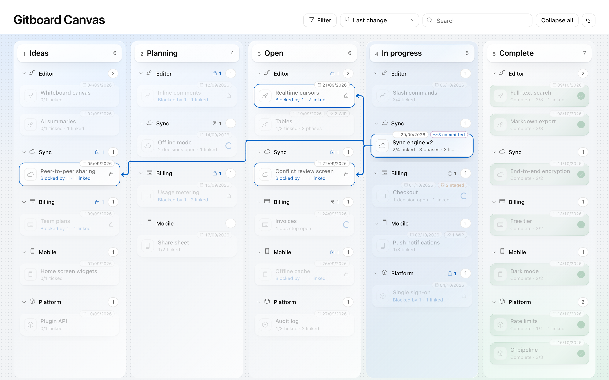

# Gitboard Canvas

Gitboard Canvas is a local kanban for product development that keeps all of its state in your repository. Each feature is a markdown file and a folder, the stage folder it sits in is its status, and moving a card on the board moves the folder with `git mv` and lands one commit.



## Quick start

```sh
npx gitboard-canvas init   # create roadmap/, stage folders, templates and gitboard.config.json
npx gitboard-canvas        # open the board on http://127.0.0.1:4610
```

Needs Node 22.12 or later and git 2.38 or later. Run both commands from any git repo. `init` never overwrites a file that exists.

To keep it in a project, run `npm i -D gitboard-canvas` and add `"board": "gitboard"` to your scripts.

## The folder is the lifecycle

| Stage | Folder | Gate to leave |
| --- | --- | --- |
| 1 Ideas | `roadmap/1.ideas/` | A person accepts the idea. |
| 2 Planning | `roadmap/2.planning/` | A person accepts the phased plan. |
| 3 Open | `roadmap/3.open/` | A person says build. |
| 4 In progress | `roadmap/4.in-progress/` | Every phase is done and verified, or a person moves it. |
| 5 Complete | `roadmap/5.complete/` | None. Finished features stay as history. |

There is no `status:` field, so a stage can never disagree with a field. Stage names, folders and count (two to nine) are set in `gitboard.config.json`. Gitboard Canvas makes a move cheap and safe. It never decides a feature is ready.

## A feature's files

A feature called `checkout-redesign` in Open is:

```
roadmap/3.open/checkout-redesign.md        the build list
roadmap/3.open/checkout-redesign/          the feature folder
  README.md                                order, rules, source items, ops actions, status, open decisions
  references.md                            research, designs, prior art
  docs/  mocks/                            longer notes and mock-ups
  phases/01-data-model.md                  one file per phase
  phases/checklist.md                      one tick list per phase
```

The file and the folder move together. Progress is counted from `- [ ]` and `- [x]` items, never from a separate tracker. See [concepts](docs/concepts.md) for phases, relations and the git pipeline.

## How a move works

1. Gitboard Canvas refuses if the feature has uncommitted changes, another worktree has unlanded work for it, the target stage already holds the slug, or another move is running.
2. It adds a temporary worktree on a new branch cut from your main branch.
3. It runs `git mv` on the file and the folder, then rewrites every link that pointed at the old path.
4. It runs your `hooks.onEnter` commands for the new stage, then the lint gate.
5. It makes one commit, fast-forwards the main branch to it, and cleans up.

If any step fails, the main branch is untouched. Gitboard Canvas never pushes, force-updates, stashes or resets, and never touches another worktree's files. The full sequence is in [concepts](docs/concepts.md#how-a-move-works).

## CLI

Installed locally the command is `gitboard`; with npx it is `npx gitboard-canvas`.

| Command | What it does |
| --- | --- |
| `gitboard` or `gitboard serve [--port N] [--open]` | Start the board. |
| `gitboard move <slug> <stage> [--from <stage>] [--dry-run]` | Make the same move as the board. `<stage>` is an id, a folder or a name. `--dry-run` prints the plan. |
| `gitboard lint` | Run the built-in checks. Exits 1 on a problem. |
| `gitboard list [--json]` | Print the board. |
| `gitboard init` | Create the lifecycle folder, templates and config. |
| `gitboard --version`, `gitboard --help` | Version and usage. |

## Configuration

Every key in `gitboard.config.json` is optional. The keys, their defaults and example hooks are in [configuration](docs/configuration.md).

## Local only

The board listens on `127.0.0.1` and `::1`, checks the Host and Origin headers, and makes no network call except `gh` for pull requests. Hooks and lint commands are code you wrote, and they run on your machine. See [SECURITY.md](SECURITY.md).

## Documents

- [Concepts](docs/concepts.md): the lifecycle, features, ticks, phases, relations, the git pipeline, moves.
- [Configuration](docs/configuration.md): every config key and hook recipes.
- [Specification](docs/spec.md): the requirements Gitboard Canvas is built against.
- [Contributing](CONTRIBUTING.md), [Code of Conduct](CODE_OF_CONDUCT.md), [Changelog](CHANGELOG.md), [Third-party notices](THIRD_PARTY_NOTICES.md).

## Licence

MIT. See [LICENSE](LICENSE).

Gitboard Canvas, Josh O'Sullivan.
